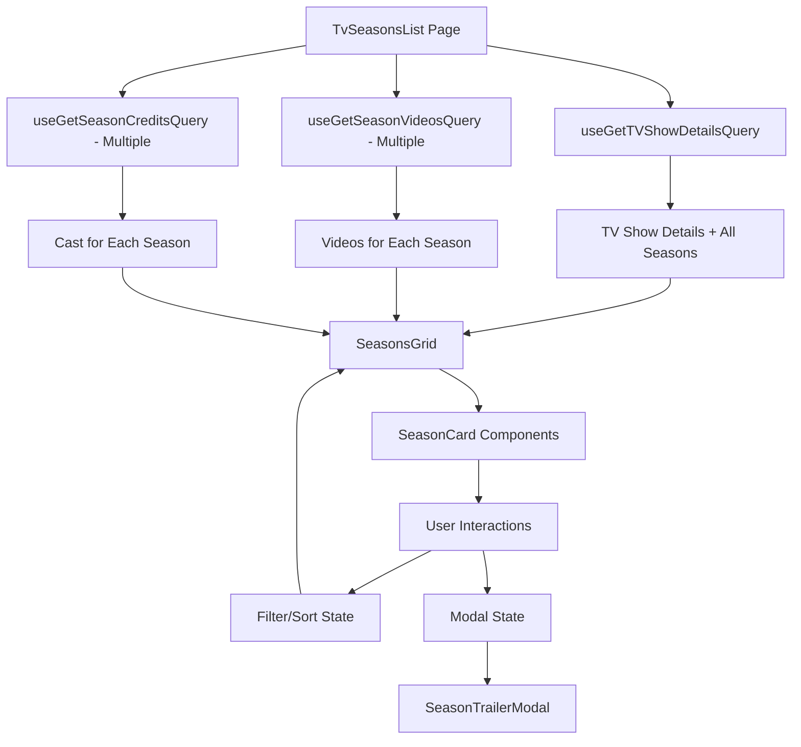

# Design Document

## Overview

TV Sezon Listesi sayfası (/tv/{id}/seasons), modern web uygulamalarının en iyi pratiklerini kullanarak tamamen yeniden tasarlanacaktır. Sayfa, TMDB API'den zengin veri çekerek kullanıcılara kapsamlı bir sezon görüntüleme deneyimi sunacaktır. Tasarım, projedeki Movies.tsx sayfasının başarılı tasarım dilini takip edecek ve glassmorphism, gradient efektler, smooth animasyonlar gibi modern UI/UX elementlerini içerecektir.

## Architecture

### Component Hierarchy

```
TvSeasonsList (Page)
├── TvSeasonsHeader (New Component)
│   ├── BackButton
│   ├── ShowInfo
│   └── StatsOverview (New Component)
│       ├── StatCard (Total Seasons)
│       ├── StatCard (Total Episodes)
│       ├── StatCard (Average Rating)
│       └── StatCard (Highest Rated Season)
├── SeasonsFilterBar (New Component)
│   ├── SortDropdown
│   ├── FilterControls
│   └── ClearFiltersButton
├── SeasonsGrid (New Component)
│   └── SeasonCard[] (Enhanced Component)
│       ├── SeasonPoster
│       ├── SeasonInfo
│       ├── SeasonStats (New)
│       ├── SeasonCastPreview (New Component)
│       ├── SeasonTrailerButton (New)
│       └── SeasonBadges (New)
└── SeasonTrailerModal (New Component)
    ├── VideoPlayer (YouTube iframe)
    ├── VideoInfo
    └── VideoList (if multiple videos)
```

### Data Flow



### State Management

```typescript
// Local Component State
interface SeasonsPageState {
  // Filter & Sort
  sortBy: 'season_number' | 'vote_average' | 'air_date' | 'episode_count';
  sortOrder: 'asc' | 'desc';
  filters: {
    minRating: number;
    yearRange: [number, number] | null;
    status: 'all' | 'completed' | 'ongoing';
  };
  
  // Modal State
  selectedVideo: {
    seasonNumber: number;
    video: Video;
  } | null;
  
  // UI State
  isFilterOpen: boolean;
}

// RTK Query Cache
- TV Show Details (existing)
- Season Videos (new, per season)
- Season Aggregate Credits (new, per season)
```

## Components and Interfaces

### 1. TvSeasonsHeader Component

**Purpose:** Modern header with show info and statistics

**Props:**
```typescript
interface TvSeasonsHeaderProps {
  tvId: string;
  tvDetail: TvDetails;
}
```

**Design:**
- Gradient background with blur effects
- Show poster thumbnail (small, 80x120px)
- Show title with year
- Back to show detail button
- Stats overview cards in a horizontal row

**Visual Style:**
```css
- Background: gradient-to-b from-slate-900 via-slate-800 to-slate-900
- Glassmorphism cards: bg-slate-800/50 backdrop-blur-lg border border-slate-700/50
- Accent colors: cyan-400 to blue-500 gradient
- Icons: Heroicons 24/solid
```

### 2. StatsOverview Component

**Purpose:** Display aggregated statistics about all seasons

**Props:**
```typescript
interface StatsOverviewProps {
  seasons: Season[];
}
```

**Stats to Display:**
1. Total Seasons (with TvIcon)
2. Total Episodes (with FilmIcon)
3. Average Rating (with StarIcon)
4. Highest Rated Season (with TrophyIcon)

**Design Pattern:**
```tsx
<div className="grid grid-cols-2 md:grid-cols-4 gap-4">
  <StatCard
    icon={<TvIcon />}
    label="Toplam Sezon"
    value={seasons.length}
    gradient="from-cyan-500 to-blue-500"
  />
</div>
```

### 3. SeasonsFilterBar Component

**Purpose:** Advanced filtering and sorting controls

**Props:**
```typescript
interface SeasonsFilterBarProps {
  sortBy: string;
  sortOrder: 'asc' | 'desc';
  filters: FilterState;
  onSortChange: (sortBy: string, order: 'asc' | 'desc') => void;
  onFilterChange: (filters: FilterState) => void;
  onClearFilters: () => void;
}
```

**Features:**
- Sort dropdown (Season #, Rating, Date, Episodes)
- Rating slider (0-10)
- Year range picker
- Status filter (All, Completed, Ongoing)
- Active filter count badge
- Clear filters button

**Design:**
- Sticky position on scroll
- Glassmorphism background
- Smooth expand/collapse animation for filters
- Mobile: Drawer/modal for filters
- Desktop: Inline filter controls

### 4. Enhanced SeasonCard Component

**Purpose:** Rich, interactive season card with comprehensive information

**Props:**
```typescript
interface SeasonCardProps {
  season: Season;
  tvId: string;
  tvName: string;
  videos?: Video[];
  cast?: CastMember[];
  isLoading?: boolean;
}
```

**Layout Structure:**
```
┌─────────────────────────────────────────────────┐
│  ┌────────┐  Season Name & Number               │
│  │        │  ⭐ 8.5 (1.2K votes)  📅 2020       │
│  │ Poster │  24 Episodes • Completed            │
│  │        │                                      │
│  │        │  Overview text...                   │
│  └────────┘                                      │
│             ┌─┬─┬─┬─┐ Cast Preview              │
│             └─┴─┴─┴─┘ +5 more                   │
│             [▶ Fragman İzle] [Detayları Gör]    │
└─────────────────────────────────────────────────┘
```

**Interactive States:**
- Default: Subtle shadow, border
- Hover: Scale 1.02, enhanced shadow, gradient overlay
- Loading: Skeleton with shimmer animation

**Responsive Behavior:**
- Mobile: Vertical layout, poster on top
- Tablet/Desktop: Horizontal layout, poster on left

### 5. SeasonCastPreview Component

**Purpose:** Show top cast members for the season

**Props:**
```typescript
interface SeasonCastPreviewProps {
  cast: CastMember[];
  maxVisible?: number; // default: 5
}
```

**Design:**
- Circular profile images (40x40px)
- Overlapping layout (negative margin)
- Tooltip on hover with actor name
- "+X more" indicator
- Click to navigate to person detail page

### 6. SeasonTrailerModal Component

**Purpose:** Full-screen video player modal

**Props:**
```typescript
interface SeasonTrailerModalProps {
  video: Video;
  allVideos?: Video[];
  onClose: () => void;
  onVideoChange?: (video: Video) => void;
}
```

**Features:**
- Full-screen overlay with backdrop blur
- YouTube iframe player with autoplay
- Video info display (type, name, official badge)
- Video list sidebar (if multiple videos)
- ESC key and click-outside to close
- Smooth scale and fade animations

## Data Models

### New TypeScript Interfaces

```typescript
// src/types/seasonVideos.ts
export interface SeasonVideo {
  id: string;
  iso_639_1: string;
  iso_3166_1: string;
  key: string;
  name: string;
  site: string;
  size: number;
  type: 'Trailer' | 'Teaser' | 'Clip' | 'Behind the Scenes' | 'Featurette' | 'Bloopers';
  official: boolean;
  published_at: string;
}

export interface SeasonVideosResponse {
  id: number;
  results: SeasonVideo[];
}

// src/types/seasonCredits.ts
export interface SeasonCastMember {
  adult: boolean;
  gender: number;
  id: number;
  known_for_department: string;
  name: string;
  original_name: string;
  popularity: number;
  profile_path: string | null;
  roles: Array<{
    credit_id: string;
    character: string;
    episode_count: number;
  }>;
  total_episode_count: number;
  order: number;
}

export interface SeasonAggregateCreditsResponse {
  cast: SeasonCastMember[];
  crew: any[];
  id: number;
}

// Extended Season interface
export interface EnhancedSeason extends Season {
  videos?: SeasonVideo[];
  cast?: SeasonCastMember[];
  isCompleted?: boolean;
  progress?: number;
}
```

### Filter and Sort State

```typescript
export type SortOption = 'season_number' | 'vote_average' | 'air_date' | 'episode_count';
export type SortOrder = 'asc' | 'desc';
export type StatusFilter = 'all' | 'completed' | 'ongoing';

export interface SeasonFilters {
  minRating: number;
  yearRange: [number, number] | null;
  status: StatusFilter;
}
```

## API Integration

### New Endpoints in tv.endpoints.ts

```typescript
// 1. Get Season Videos
getSeasonVideos: builder.query<SeasonVideosResponse, { tvId: string; seasonNumber: number }>({
  query: ({ tvId, seasonNumber }) => 
    `/tv/${tvId}/season/${seasonNumber}/videos?language=${LANGUAGE}`,
  providesTags: (result, error, { tvId, seasonNumber }) => [
    { type: 'SeasonVideos', id: `${tvId}-${seasonNumber}` }
  ],
}),

// 2. Get Season Aggregate Credits
getSeasonAggregateCredits: builder.query<SeasonAggregateCreditsResponse, { tvId: string; seasonNumber: number }>({
  query: ({ tvId, seasonNumber }) => 
    `/tv/${tvId}/season/${seasonNumber}/aggregate_credits?language=${LANGUAGE}`,
  providesTags: (result, error, { tvId, seasonNumber }) => [
    { type: 'SeasonCredits', id: `${tvId}-${seasonNumber}` }
  ],
}),
```

### Data Fetching Strategy

**Approach:** Parallel fetching with progressive enhancement

```typescript
// In TvSeasonsList component
const { data: tvDetail, isLoading: isTvLoading } = useGetTVShowDetailsQuery(tvId!);

// Fetch videos and credits for each season in parallel
const seasonEnhancements = tvDetail?.seasons.map((season) => ({
  season,
  videos: useGetSeasonVideosQuery(
    { tvId: tvId!, seasonNumber: season.season_number },
    { skip: !tvId }
  ),
  credits: useGetSeasonAggregateCreditsQuery(
    { tvId: tvId!, seasonNumber: season.season_number },
    { skip: !tvId }
  ),
}));
```

## Error Handling

### Error Scenarios

1. **TV Show Not Found** - Display custom 404 component
2. **Network Error** - Display error banner with retry button
3. **Partial Data Failure** - Show season cards with available data
4. **Video Playback Error** - Error message in modal

### Error UI Components

```tsx
<div className="bg-red-500/10 border border-red-500/30 rounded-xl p-4">
  <div className="flex items-center gap-3">
    <ExclamationTriangleIcon className="h-6 w-6 text-red-400" />
    <div className="flex-1">
      <h3 className="text-red-400 font-semibold">Veri yüklenirken hata oluştu</h3>
      <p className="text-red-300 text-sm">Lütfen tekrar deneyin</p>
    </div>
    <button className="px-4 py-2 bg-red-500/20 hover:bg-red-500/30 
                       rounded-lg text-red-400 transition-colors">
      Tekrar Dene
    </button>
  </div>
</div>
```

## Testing Strategy

### Unit Tests

**Components to Test:**
1. StatsOverview - Correct calculation of aggregated stats
2. SeasonCastPreview - Proper rendering of cast members
3. SeasonsFilterBar - Filter and sort logic
4. SeasonCard - Conditional rendering based on data availability

### Integration Tests

**Scenarios:**
1. Full page load with all data
2. Page load with partial data
3. Filter application and result update
4. Sort change and list reordering
5. Modal open/close with video playback

## Performance Optimization

### 1. Data Fetching Optimization

**Strategy:** Staggered loading with priority

- Priority 1: TV Show Details (blocking)
- Priority 2: First 3 seasons (immediate)
- Priority 3: Remaining seasons (lazy with Intersection Observer)

### 2. Rendering Optimization

```typescript
// Memoize expensive calculations
const sortedAndFilteredSeasons = useMemo(() => {
  return applySortAndFilter(seasons, sortConfig, filters);
}, [seasons, sortConfig, filters]);

// Memoize season cards
const SeasonCard = memo(({ season, ...props }: SeasonCardProps) => {
  // Component implementation
});
```

### 3. Image Optimization

- Use appropriate image sizes from TMDB
- Implement lazy loading with `loading="lazy"`
- Use blur placeholder while loading
- WebP format support

### 4. Animation Performance

- Use CSS transforms (not position/size changes)
- Use `will-change` sparingly
- Debounce filter/sort changes

## Accessibility

### Keyboard Navigation

- All interactive elements focusable with Tab
- Modal closable with ESC
- Filter controls accessible via keyboard
- Focus trap in modal

### ARIA Attributes

```tsx
// Season Card
<article
  role="article"
  aria-labelledby={`season-${season.season_number}-title`}
>
  <h3 id={`season-${season.season_number}-title`}>{season.name}</h3>
</article>

// Trailer Button
<button
  aria-label={`${season.name} fragmanını izle`}
  aria-haspopup="dialog"
>
  Fragman İzle
</button>

// Modal
<div role="dialog" aria-modal="true">
  {/* Modal content */}
</div>
```

### Color Contrast

**WCAG AA Compliance:**
- Text on background: minimum 4.5:1 ratio
- Large text: minimum 3:1 ratio
- Interactive elements: clear focus indicators

## Visual Design System

### Color Palette

```typescript
const colors = {
  background: {
    primary: 'slate-900',
    secondary: 'slate-800',
    tertiary: 'slate-700',
  },
  accent: {
    primary: 'cyan-400',
    secondary: 'blue-500',
    gradient: 'from-cyan-400 to-blue-500',
  },
  status: {
    success: 'green-400',
    warning: 'yellow-400',
    error: 'red-400',
  },
  text: {
    primary: 'white',
    secondary: 'slate-300',
    tertiary: 'slate-400',
  },
};
```

### Typography

```typescript
const typography = {
  h1: 'text-4xl font-bold',
  h2: 'text-2xl font-bold',
  h3: 'text-xl font-semibold',
  body: 'text-base',
  small: 'text-sm',
};
```

### Component Patterns

**Glassmorphism Card:**
```css
.glass-card {
  @apply bg-slate-800/50 backdrop-blur-lg border border-slate-700/50 rounded-xl;
}
```

**Hover Effect:**
```css
.hover-lift {
  @apply transition-all duration-300 hover:scale-102 hover:shadow-2xl hover:shadow-cyan-500/20;
}
```

## Animation Specifications

### Page Load Animation

```typescript
const containerVariants = {
  hidden: { opacity: 0 },
  visible: {
    opacity: 1,
    transition: { staggerChildren: 0.1 },
  },
};

const itemVariants = {
  hidden: { opacity: 0, y: 20 },
  visible: {
    opacity: 1,
    y: 0,
    transition: { duration: 0.5, ease: 'easeOut' },
  },
};
```

### Hover Animations

```css
.season-card {
  transition: transform 0.3s cubic-bezier(0.4, 0, 0.2, 1),
              box-shadow 0.3s cubic-bezier(0.4, 0, 0.2, 1);
}

.season-card:hover {
  transform: scale(1.02);
  box-shadow: 0 20px 25px -5px rgba(34, 211, 238, 0.2);
}
```

## Responsive Breakpoints

```typescript
const breakpoints = {
  mobile: '0px',      // < 640px
  tablet: '640px',    // 640px - 1024px
  desktop: '1024px',  // 1024px - 1280px
  wide: '1280px',     // > 1280px
};

const gridConfig = {
  mobile: 'grid-cols-1',
  tablet: 'sm:grid-cols-2',
  desktop: 'lg:grid-cols-2',
  wide: 'xl:grid-cols-3',
};
```

## Implementation Notes

### Development Phases

**Phase 1: Core Structure**
- Create new component files
- Set up basic layout and routing
- Implement TV show details fetch

**Phase 2: API Integration**
- Add new endpoints to tv.endpoints.ts
- Create TypeScript types
- Implement data fetching hooks

**Phase 3: UI Components**
- Build StatsOverview component
- Create enhanced SeasonCard
- Implement SeasonCastPreview
- Build SeasonTrailerModal

**Phase 4: Filtering & Sorting**
- Implement filter logic
- Add sort functionality
- Create filter UI controls

**Phase 5: Polish & Optimization**
- Add animations
- Implement lazy loading
- Optimize performance
- Add accessibility features

**Phase 6: Testing & Refinement**
- Write unit tests
- Conduct accessibility audit
- Performance testing
- Bug fixes

### Technical Considerations

1. **RTK Query Caching** - Use appropriate cache times and invalidation
2. **Bundle Size** - Code split modal component, lazy load dependencies
3. **Browser Compatibility** - Test on Chrome, Firefox, Safari, Edge
4. **Mobile Performance** - Reduce image sizes, simplify animations

### Migration from Current Implementation

**Current State:**
- Basic season list with minimal info
- Simple card layout
- No filtering or sorting
- No video integration

**Migration Steps:**
1. Keep existing TvSeasonsList route
2. Create new components alongside old ones
3. Gradually replace old components
4. Test thoroughly before removing old code
5. Update any dependent components

## Conclusion

This design provides a comprehensive blueprint for transforming the TV seasons list page into a modern, feature-rich experience. The implementation follows established patterns from the project (Movies.tsx), leverages TMDB API effectively, and prioritizes user experience, performance, and accessibility.
